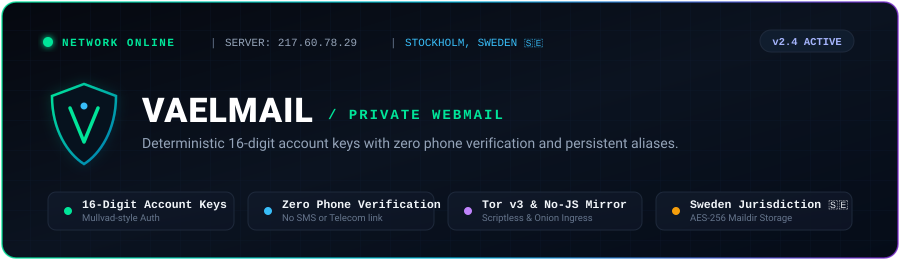
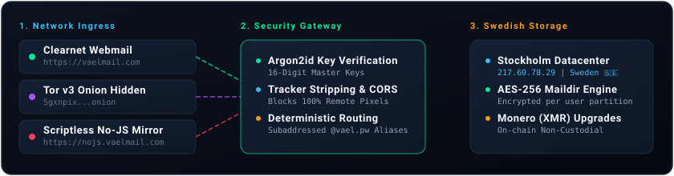

<p align="center">
  <a href="https://vaelmail.com">
    
  </a>
</p>

<p align="center">
  <a href="https://vaelmail.com"></a>
  <a href="https://nojs.vaelmail.com"></a>
  <a href="http://5gxnpixptykyv5fchr2qidjbrazjewswx77ddrqowpcmwmmgll57daid.onion"></a>
  <a href="https://monerica.com/site/vaelmail"></a>
  
  
</p>

---

## Interactive Session Demo

<p align="center">
  
</p>

---

## Architectural Philosophy

Mainstream email registration has devolved into an invasive identity audit: mandatory mobile numbers link mailboxes directly to telecom databases and physical hardware.

VaelMail eliminates this compromise entirely. Inspired by the Mullvad VPN security model, mailboxes authenticate using deterministic, client-generated **16-digit account keys** derived through memory-hard **Argon2id** password hashing. 

* **Zero Identity Linkage**: No phone verification, SMS prompts, passwords on disk, or recovery email demands.
* **Persistent Aliases (`@vael.pw`)**: Shield your real inbox against cross-site data breaches and advertising trackers.
* **Scriptless Ingress**: Mitigate client-side browser fingerprinting and zero-day JavaScript exploits via our dedicated SSR mirror.

---

## Multi-Layer Architecture

<p align="center">
  
</p>

```
       [ Client Ingress ]
       /       |        \
( HTTPS )  ( Tor v3 )  ( No-JS SSR )
       \       |        /
    [ Reverse Proxy & Postfix ]
               |
  [ Argon2id Key Verification ]
               |
  [ Encrypted Maildir (Stockholm, Sweden 🇸🇪) ]
```

---

## Plan Comparison

| Feature | Free Tier | Plus Tier |
| :--- | :--- | :--- |
| **Mailbox Storage** | **50 MB** receive-only | **1 GB** send &amp; receive |
| **Authentication** | 16-Digit Master Key | 16-Digit Master Key |
| **Hardware Passkeys** | WebAuthn (FIDO2) | WebAuthn (FIDO2) |
| **Persistent Aliases** | 3 `@vael.pw` aliases | Unlimited custom &amp; `@vael.pw` aliases |
| **Subaddressing** | Unlimited (`user+tag@domain`) | Unlimited (`user+tag@domain`) |
| **Tor v3 Hidden Service** | Supported | Supported |
| **Scriptless No-JS Mirror** | Supported | Supported |
| **Custom Domains** | - | Supported (Full DNS &amp; DKIM control) |
| **Outbound SMTP Sending** | - | Supported |
| **Payment Options** | Free ($0 / no card needed) | Monero (XMR), Bitcoin (BTC), Card (5 EUR/mo) |

---

## Cryptographic Posture & Operational Specs

* **Server Infrastructure**: Stockholm, Stockholms län, Sweden (`217.60.78.29 | AS51852`).
* **Authentication Primitive**: Argon2id (`m=65536, t=3, p=4`) with optional WebAuthn FIDO2 hardware passkeys.
* **Mail Storage**: Maildir format on encrypted partitions with per-mailbox isolation.
* **Zero Telemetry**: No Google Analytics, CDN tracking beacons, remote fonts, or commercial ad scripts.

---

## Official Endpoints & Security

* **Clearnet Webmail**: [https://vaelmail.com](https://vaelmail.com)
* **Scriptless No-JS Mirror**: [https://nojs.vaelmail.com](https://nojs.vaelmail.com)
* **Tor v3 Onion Endpoint**: `http://5gxnpixptykyv5fchr2qidjbrazjewswx77ddrqowpcmwmmgll57daid.onion`
* **Technical Documentation**: [https://vaelmail.com/blog](https://vaelmail.com/blog)
* **Support Email**: `vael-support@vael.email`
* **PGP Fingerprint**: `0C5A 1CF2 7DC4 F5E6 9C72 D807 E490 17C3 6DED F1E6`
* **Security Policy**: [SECURITY.md](SECURITY.md)
