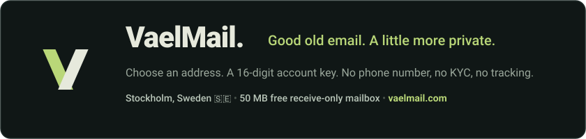

<p align="center">
  <a href="https://vaelmail.com">
    
  </a>
</p>

<p align="center">
  <a href="https://vaelmail.com"></a>
  <a href="https://nojs.vaelmail.com"></a>
  <a href="http://5gxnpixptykyv5fchr2qidjbrazjewswx77ddrqowpcmwmmgll57daid.onion"></a>
  <a href="https://monerica.com/site/vaelmail"></a>
  
  
</p>

---

### A number. Not your life story.

Choose an address. No name, phone number, recovery email, or password required. Accounts authenticate using client-generated **16-digit account numbers** derived with **Argon2id**. 

Keep your number somewhere safe. If your account number is lost, the account cannot be recovered.

```
       [ Client Ingress ]
       /       |        \
( HTTPS )  ( Tor v3 )  ( No-JS SSR )
       \       |        /
    [ Reverse Proxy & Postfix ]
               |
  [ Argon2id Authentication ]
               |
  [ Encrypted Maildir (Stockholm, Sweden 🇸🇪) ]
```

---

### One inbox. A few different doors.

* **Clearnet Webmail**: Fast, scriptless-capable webmail at [vaelmail.com](https://vaelmail.com).
* **Scriptless No-JS Mirror**: Pure server-side rendered HTML webmail at [nojs.vaelmail.com](https://nojs.vaelmail.com) to eliminate JavaScript exploit surfaces and browser fingerprinting.
* **Tor v3 Onion Service**: Direct onion routing at `http://5gxnpixptykyv5fchr2qidjbrazjewswx77ddrqowpcmwmmgll57daid.onion`.
* **Persistent Aliases (`@vael.pw`)**: Shield your real address against data breaches and cross-site tracking. Aliases route permanently into your inbox.

---

### Plan Comparison

| Feature | Free Tier | Plus Tier |
| :--- | :--- | :--- |
| **Mailbox Storage** | **50 MB** receive-only | **1 GB** send &amp; receive |
| **Authentication** | 16-Digit Account Key | 16-Digit Account Key |
| **Hardware Passkeys** | WebAuthn (FIDO2) | WebAuthn (FIDO2) |
| **Persistent Aliases** | 3 `@vael.pw` aliases | Unlimited custom &amp; `@vael.pw` aliases |
| **Subaddressing** | Unlimited (`user+tag@domain`) | Unlimited (`user+tag@domain`) |
| **Tor v3 Onion Service** | Supported | Supported |
| **Scriptless No-JS Mirror** | Supported | Supported |
| **Custom Domains** | - | Supported (Full DNS &amp; DKIM control) |
| **Outbound SMTP Sending** | - | Supported |
| **Pricing** | Free ($0 / no card required) | Monero (XMR), Bitcoin (BTC), Card (5 EUR/mo) |

---

### Technical & Cryptographic Specifications

* **Server Infrastructure**: Stockholm, Stockholms län, Sweden (`217.60.78.29 | AS51852`).
* **Authentication Primitive**: Argon2id (`m=65536, t=3, p=4`) with optional WebAuthn FIDO2 passkeys.
* **Mail Storage**: Maildir format on encrypted partitions with per-mailbox isolation.
* **Zero Telemetry**: No Google Analytics, tracking beacons, remote fonts, or commercial ad scripts.

---

### Official Resources

* **Webmail**: [https://vaelmail.com](https://vaelmail.com)
* **Scriptless No-JS Mirror**: [https://nojs.vaelmail.com](https://nojs.vaelmail.com)
* **Tor v3 Onion Endpoint**: `http://5gxnpixptykyv5fchr2qidjbrazjewswx77ddrqowpcmwmmgll57daid.onion`
* **Technical Documentation**: [https://vaelmail.com/blog](https://vaelmail.com/blog)
* **Support Email**: `vael-support@vael.email`
* **PGP Fingerprint**: `0C5A 1CF2 7DC4 F5E6 9C72 D807 E490 17C3 6DED F1E6`
* **Security Policy**: [SECURITY.md](SECURITY.md)
